# Modèle de données (DB-02, DB-03)

> **Statut :** modèle relationnel initial validé par le propriétaire du projet (DB-02, 2026-11-23).
> Schéma : `prisma/schema.prisma`. Migrations : `prisma/migrations/20261123092444_init/`, `20261123125545_auth_user_fields/` (AUTH-01), `20261124090906_auth_sessions/` (AUTH-05 à AUTH-10).
> Données de référence : `prisma/seed/reference-data.ts` (valeurs de `docs/gameplay/rules.md`).

## 1. Périmètre

| Inclus | Hors périmètre (ticket) |
|---|---|
| Comptes (`users`) : hash du mot de passe, rôle et statut (AUTH-01, AUTH-06, AUTH-08) ; sessions de connexion (`sessions`, AUTH-05) ; personnages (`characters`) | Nettoyage des sessions expirées (reporté) ; changement de mot de passe (aucun ticket) |
| Données de référence du MVP : classes, zone, monstres, objets, butin | Instances de monstres et combats (WORLD-07, COMBAT-01) |
| | Inventaire et exemplaires d'objets (ITEM-02), portefeuille (ECO-01) |
| | Statistiques stockées : elles se **calculent** à partir de la classe et du niveau (STAT-01) |
| | Coups critiques : hors MVP, non stockés (COMBAT-05) |

## 2. Diagramme

```mermaid
erDiagram
    users ||--o{ characters : "possède (cascade)"
    users ||--o{ sessions : "se connecte (cascade)"
    character_classes ||--o{ characters : "classe (restriction)"
    zones ||--o{ characters : "zone courante (restriction)"
    zones ||--o{ zone_monsters : "contient (restriction)"
    monsters ||--o{ zone_monsters : "présent dans (restriction)"
    monsters ||--o| loot_entries : "butin (restriction)"
    items ||--o{ loot_entries : "objet (restriction)"

    users {
        uuid id PK
        text name
        text email UK "minuscules"
        text password_hash "Argon2id"
        user_role role "PLAYER ou ADMIN"
        user_status status "ACTIVE ou DISABLED"
    }
    sessions {
        uuid id PK
        uuid user_id FK
        text token_hash UK "SHA-256 hexadécimal"
        timestamptz expires_at
        timestamptz revoked_at "null si active"
    }
    characters {
        uuid id PK
        uuid user_id FK
        uuid class_id FK
        uuid current_zone_id FK "obligatoire"
        text name "3 à 16 lettres"
        text normalized_name UK "lower(name)"
        int level "1 à 10"
        int experience "≥ 0"
    }
    character_classes {
        uuid id PK
        text code UK
        text name
        int base_hp_mana_attack_defense_speed
        int per_level_hp_mana_attack_defense_speed
    }
    zones {
        uuid id PK
        text code UK
        text name
        int min_level
        int max_level
    }
    monsters {
        uuid id PK
        text code UK
        text name
        int level
        int hp_attack_defense_speed
        int xp_reward
    }
    zone_monsters {
        uuid zone_id PK,FK
        uuid monster_id PK,FK
    }
    items {
        uuid id PK
        text code UK
        text name
        item_type type "MATERIAL"
        bool stackable
    }
    loot_entries {
        uuid monster_id PK,FK
        uuid item_id FK
        int drop_chance_bp "0 à 10 000"
    }
```

Pour la lisibilité, le diagramme regroupe les colonnes de statistiques et omet les dates. Toutes les tables, sauf `zone_monsters` et `loot_entries`, ont `created_at` et `updated_at`.

## 3. Conventions

- Clés primaires : UUID v7 générés par PostgreSQL 18 (`DEFAULT uuidv7()`), type `uuid`.
- Données de référence : en plus de l'UUID, un `code` unique et stable (`warrior`, `clearing`, `wolf`…), qui sert de clé au seed. L'API exposera l'UUID (conventions §7).
- Tables et colonnes en snake_case ; modèles Prisma en PascalCase (`CharacterClass` plutôt que `Class`, mot réservé).
- Dates en `timestamptz(3)`. `created_at` est rempli par PostgreSQL ; `updated_at` est mis à jour par Prisma (`@updatedAt`), pas par la base : toute écriture doit passer par les repositories (DB-04).
- Pourcentages et probabilités en entiers : `drop_chance_bp` est en points de base (5 000 = 0,5).

## 4. Tables

| Table | Rôle | Colonnes | Contraintes |
|---|---|---|---|
| `users` | Compte joueur | `id`, `name`, `email`, `password_hash` (obligatoire), `role` (enum `user_role` : `PLAYER`, `ADMIN` ; `PLAYER` par défaut), `status` (enum `user_status` : `ACTIVE`, `DISABLED` ; `ACTIVE` par défaut), dates | `email` unique ; `users_email_lowercase_check` : `email = lower(email)`. `password_hash` n'est lu que pour la connexion (`findCredentialsByEmail`) |
| `sessions` | Session de connexion (AUTH-05) | `id`, `user_id`, `token_hash`, `created_at`, `expires_at`, `revoked_at` (nul tant que la session est active) | `token_hash` unique ; `sessions_token_hash_check` : `^[0-9a-f]{64}$` (empreinte SHA-256, jamais le jeton) ; index sur `user_id`. Pas de `updated_at` : seule `revoked_at` change |
| `characters` | Personnage d'un joueur | `id`, `user_id`, `class_id`, `current_zone_id`, `name`, `normalized_name`, `level` (1 par défaut), `experience` (0 par défaut), dates | `normalized_name` unique ; `characters_name_format_check` : `^[A-Za-z]{3,16}$` ; `characters_normalized_name_check` : `= lower(name)` ; `characters_level_check` : 1 à 10 ; `characters_experience_check` : ≥ 0 ; index sur les trois clés étrangères |
| `character_classes` | Classe jouable (rules.md §2) | `id`, `code`, `name`, `base_hp`, `base_mana`, `base_attack`, `base_defense`, `base_speed`, `hp_per_level`, `mana_per_level`, `attack_per_level`, `defense_per_level`, `speed_per_level`, dates | `code` unique ; `base_hp` ≥ 1 et autres valeurs ≥ 0 (deux `CHECK`) |
| `zones` | Zone du monde (rules.md §8) | `id`, `code`, `name`, `min_level`, `max_level`, dates | `code` unique ; `zones_level_range_check` : 1 ≤ `min_level` ≤ `max_level` |
| `monsters` | Modèle de monstre (rules.md §8) | `id`, `code`, `name`, `level`, `hp`, `attack`, `defense`, `speed`, `xp_reward`, dates | `code` unique ; `monsters_stats_check` : `level` et `hp` ≥ 1, autres valeurs ≥ 0 |
| `zone_monsters` | Monstres présents dans une zone | `zone_id`, `monster_id` | Clé primaire (`zone_id`, `monster_id`) ; index sur `monster_id` |
| `items` | Définition d'objet (rules.md §8) | `id`, `code`, `name`, `type` (enum `item_type` : `MATERIAL`), `stackable`, dates | `code` unique |
| `loot_entries` | Butin d'un monstre (rules.md §7) | `monster_id`, `item_id`, `drop_chance_bp` | Clé primaire `monster_id` (au plus un objet par monstre) ; `loot_entries_drop_chance_check` : 0 à 10 000 ; index sur `item_id`. La quantité, toujours 1 au MVP, n'est pas stockée |

Les contraintes `CHECK` ne sont pas exprimables dans le schéma Prisma : elles sont écrites à la fin de la migration `init` et vérifiées par `tests/database/schema-constraints.test.ts`. Prisma ne les supprime pas lors des migrations suivantes.

## 5. Politique de suppression

| Relation | Règle | Effet |
|---|---|---|
| `users` → `characters` | **Cascade** | Supprimer un compte supprime ses personnages |
| `users` → `sessions` | **Cascade** | Supprimer un compte supprime ses sessions, dans la même instruction que ses personnages |
| `character_classes` → `characters` | **Restriction** | Une classe utilisée par un personnage ne peut pas être supprimée |
| `zones` → `characters` | **Restriction** | La zone courante d'un personnage ne peut pas être supprimée |
| `zones` → `zone_monsters`, `monsters` → `zone_monsters` | **Restriction** | Une zone ou un monstre associé ne peut pas être supprimé |
| `monsters` → `loot_entries`, `items` → `loot_entries` | **Restriction** | Un monstre ou un objet utilisé par une entrée de butin ne peut pas être supprimé |

Règle générale : les données de référence utilisées ne sont jamais supprimées implicitement. Pour retirer un élément, il faut d'abord supprimer explicitement ses associations. PostgreSQL signale un refus par le code `23001` (`restrict_violation`). L'archivage éventuel des personnages sera décidé en CHAR-07.

## 6. Invariants : où sont-ils garantis ?

| Règle (rules.md) | Base de données | Service (ticket) |
|---|---|---|
| Nom de personnage : 3 à 16 lettres A–Z ou a–z | `CHECK` | Validation Zod avec le même motif (`CHARACTER_NAME_PATTERN`), vérifiée identique à la contrainte SQL par un test (CHAR-02, CHAR-03) |
| Nom unique sans tenir compte de la casse | `normalized_name` unique + `CHECK` | Remplir `normalized_name = lower(name)` ; 409 `CHARACTER_NAME_TAKEN` (CHAR-03) |
| Email unique sans tenir compte de la casse | `email` unique + `CHECK` minuscules | Normaliser l'email (minuscules) avant écriture (DB-04, AUTH-04) |
| Mot de passe jamais stocké en clair | `password_hash` obligatoire | Hash Argon2id calculé par le service avant écriture ; jamais renvoyé (AUTH-03, AUTH-04) |
| Jeton de session jamais stocké | `sessions_token_hash_check` (64 caractères hexadécimaux) | Seule l'empreinte SHA-256 est écrite (AUTH-05) |
| Session valide : non révoquée, non expirée, compte actif | — | Vérifié à chaque requête par le service d'authentification, avec son horloge (AUTH-07) |
| 5 personnages au maximum par compte | — | `createWithinLimit` : transaction avec verrou sur la ligne du compte (`SELECT … FOR UPDATE`), comptage puis insertion ; seule méthode de création ; 409 `CHARACTER_LIMIT_REACHED` (CHAR-02, CHAR-03) |
| Un personnage appartient au compte qui l'a créé | `user_id` obligatoire, cascade | Propriétaire tiré du jeton ; lecture par le seul propriétaire, sinon 404 (CHAR-03 à CHAR-05) |
| Niveau 1 à 10, XP ≥ 0 | `CHECK` | Calcul de progression (STAT-03, STAT-04) |
| Zone de départ attribuée à la création | `current_zone_id` obligatoire | Attribuer la zone de code `clearing` (`STARTING_ZONE_CODE`), jamais une valeur fournie par le client (DB-04, CHAR-03) |
| Probabilité de butin entre 0 et 1 | `CHECK` 0 à 10 000 | Tirage aléatoire injectable (REWARD-01) |

## 7. Responsabilités pour les tickets suivants

- **DB-04 (réalisé)** : le service utilisateur écrit `email` en minuscules ; le repository des personnages (`src/repositories/character.repository.ts`) remplit `normalized_name = lower(name)` et place tout nouveau personnage dans la zone `clearing` (`STARTING_ZONE_CODE`, `src/config/gameplay.ts`) ; les identifiants des utilisateurs sont des UUID dans l'API. Listes triées par `created_at`, puis `id`.
- **AUTH-01 (réalisé)** : migration `auth_user_fields` (`password_hash`, `role`).
- **AUTH-05 à AUTH-10 (réalisés)** : migration `auth_sessions` : valeur `ADMIN` ajoutée à `user_role`, colonne `status`, table `sessions`. Les sessions expirées ou révoquées restent en base ; leur nettoyage est reporté.
- **CHAR-01 à CHAR-05 (réalisés)** : aucune migration ; classes lues en lecture seule, personnages créés uniquement par `createWithinLimit`. Pas d'état supplémentaire du personnage au MVP.
- **WORLD-01 à 03, ITEM-01, REWARD-01** : les tables existent et sont remplies par le seed. Ces tickets ajoutent repositories, services et endpoints, et d'éventuelles colonnes par de nouvelles migrations.
- **COMBAT-01, WORLD-07, ITEM-02** : nouvelles tables (combats, instances, inventaire) par de nouvelles migrations.

## Historique

| Date | Changement |
|---|---|
| 2026-11-23 | Création (DB-02, DB-03) |
| 2026-11-23 | Responsabilités de DB-04 réalisées (section 7) |
| 2026-11-23 | `password_hash` et `role` ajoutés à `users` (AUTH-01) |
| 2026-11-24 | Rôle `ADMIN`, statut des comptes et table `sessions` (AUTH-05 à AUTH-10) |
| 2026-11-24 | Règles de propriété et de création des personnages (CHAR-01 à CHAR-05), sans migration |
